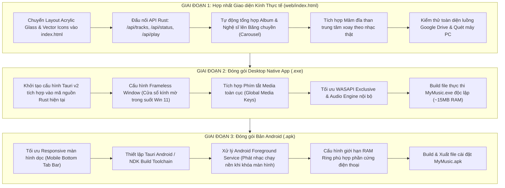

# 📋 KẾ HOẠCH TRIỂN KHAI ỨNG DỤNG MYMUSIC HI-RES (3 GIAI ĐOẠN)

> **Mục tiêu:** Xây dựng hoàn chỉnh hệ sinh thái nghe nhạc Hi-Res Audiophile cá nhân, hỗ trợ truyền phát trực tiếp từ Google Drive & Bộ nhớ máy với công nghệ đệm RAM xoay vòng (Zero-Disk Storage), giao diện chuẩn **Windows 11 Acrylic Glass (Mica / Frosted Glass)**, và đóng gói đa nền tảng (**Desktop Windows .exe** & **Mobile Android .apk**).

---

## 🗺️ Sơ đồ Lộ trình Tổng thể

---

## 💎 GIAI ĐOẠN 1: Hợp nhất Giao diện Kính mới vào Ứng dụng thật (`web/index.html`)

### 1.1. Mục tiêu công việc
* Thay thế toàn bộ mã giao diện cũ trong `web/index.html` bằng kiến trúc **Windows 11 Acrylic Glass** đã được kiểm chứng ở bản preview.
* Giữ nguyên và kết nối 100% logic Backend Rust hiện hữu (Zero-Disk RAM Ring buffer, Direct PCM stream, Drive synchronization, Quản lý album & ảnh bìa).

### 1.2. Chi tiết các hạng mục thực hiện
1. **Di chuyển CSS & DOM Tree mới:**
   * Nền hiệu ứng Mica/Acrylic với các khối cầu sáng chuyển động (`ambient-bg blobs`).
   * Thanh điều hướng trên cùng (Titlebar) tích hợp ô tìm kiếm trung tâm chuẩn Nuclear (`Ctrl + K`) và nút `[+ Thêm Nhạc]`.
   * Sidebar kính mờ chia 2 phân khu: *Thư viện* và *Nguồn nhạc (Local / Drive / Offline)* cùng thẻ giám sát *Zero-Disk RAM*.
   * Băng chuyền thẻ kính (Carousel) tự động tính toán số lượng bài của từng Nghệ sĩ & Album từ thư viện thật.
   * Bảng danh sách bài hát dạng kính mờ (Frosted Tracklist) với các chỉ số Hi-Res (`24-bit/96kHz`, `RAM Ready`, nguồn Drive/Local).
   * Thanh Player đáy tinh gọn: Click vào đĩa than mini hoặc tên bài hát để mở mâm đĩa xoay trung tâm.
2. **Đấu nối JavaScript logic thật:**
   * Thay thế dữ liệu tĩnh mẫu bằng dữ liệu trả về từ `GET /api/tracks` và `GET /api/status`.
   * Khởi tạo hàm phân nhóm động: gom nhóm các bài hát có cùng `artist` hoặc `album` để tự động render lên băng chuyền Top Artists & Top Albums.
   * Gắn lại toàn bộ các Modal chức năng:
     * Modal đồng bộ thư mục Google Drive (kèm danh sách bookmark đã lưu).
     * Modal quét thư mục ổ cứng máy tính PC (`dialog/pick_folder`).
     * Modal gán/tạo album và đổi ảnh bìa tùy chỉnh.
     * Modal xác nhận xóa bài hát.

### 1.3. ⚠️ Các điểm có nguy cơ lỗi & Giải pháp kỹ thuật

> [!WARNING] **Nguy cơ lỗi 1.1: Xung đột Z-Index và hiện tượng mờ đè mờ (Backdrop-filter nesting)**
> * **Hiện tượng:** Khi mở Modal (như modal Google Drive hoặc mâm đĩa than) trên nền kính mờ có `backdrop-filter: blur()`, các trình duyệt nhân Chromium có thể bị lỗi render làm đen màn hình, nhấp nháy hoặc không nhấn được các nút bấm bên trong.
> * **Giải pháp:** Thiết lập cấu trúc DOM phẳng (Flat DOM): Modal và Overlay đĩa than phải là các phần tử con trực tiếp của thẻ `<body>`, đặt `z-index: 999999` với nền đen mờ vững chắc (`background: rgba(6, 8, 13, 0.95)`) thay vì lồng nhiều lớp blur vào nhau.

> [!WARNING] **Nguy cơ lỗi 1.2: Băng chuyền Album/Nghệ sĩ bị tràn bộ nhớ hoặc lag khi thư viện có hàng nghìn bài**
> * **Hiện tượng:** Nếu thư viện nạp nhiều album cùng lúc, việc tính toán phân nhóm và tải đồng loạt hàng trăm ảnh bìa sẽ làm đơ giao diện.
> * **Giải pháp:** Áp dụng Lazy-loading cho hình ảnh (`loading="lazy"`), giới hạn hiển thị tối đa 12 thẻ nổi bật nhất trên Carousel, có nút điều hướng cuộn ngang mượt mà (`scrollBy({ behavior: 'smooth' })`).

> [!WARNING] **Nguy cơ lỗi 1.3: Mất đồng bộ trạng thái phát khi Polling**
> * **Hiện tượng:** Thanh Seekbar thời gian chạy và đĩa than xoay có thể bị khựng nếu hàm `pollStatus()` chạy chậm hoặc phản hồi trễ từ server.
> * **Giải pháp:** Tách biệt Animation và Polling: CSS animation xoay đĩa than chạy độc lập dựa trên trạng thái `isPlaying` của audio engine. Seekbar nội suy mượt mà (smooth interpolation) giữa các chu kỳ cập nhật 500ms.

---

## 📦 GIAI ĐOẠN 2: Đóng gói thành Desktop Native App (.exe độc lập)

### 2.1. Mục tiêu công việc
* Biến ứng dụng từ dạng "chạy server nền + mở trình duyệt web" thành **1 ứng dụng Windows nguyên bản (.exe)** như Spotify hay Tidal.
* Sử dụng **Tauri v2**: Tích hợp trực tiếp mã Rust hiện tại vào nhân của Tauri, sử dụng WebView2 có sẵn trên Windows.

### 2.2. Chi tiết các hạng mục thực hiện
1. **Thiết lập Tauri v2 Workspace:**
   * Cài đặt Tauri CLI: `cargo install tauri-cli --version "^2.0"`.
   * Chuyển đổi mã nguồn `src/main.rs`: Thay vì chỉ chạy Axum HTTP server ở cổng 4080, Tauri sẽ nhúng trực tiếp giao diện `web/` vào cửa sổ WebView2 native, gọi trực tiếp các hàm Rust qua hệ thống **Tauri IPC Command** (hoặc giữ Axum làm local daemon backend).
2. **Cấu hình Cửa sổ Windows Acrylic Fluent:**
   * Cấu hình `tauri.conf.json`:
     * `decorations: false` (Ẩn thanh tiêu đề mặc định thô của Windows).
     * `transparent: true` (Bật tính năng trong suốt để nhận hiệu ứng kính Acrylic/Mica của Windows 11).
     * Window Controls: Gắn sự kiện Minimize, Maximize, Close vào các nút bấm kính ở góc trên bên phải.
3. **Tích hợp tính năng Native:**
   * Phím tắt bàn phím toàn cục (Global Media Shortcuts): Bấm Play/Pause, Next, Prev trên bàn phím thì ứng dụng nhận lệnh ngay cả khi đang thu nhỏ dưới Taskbar / System Tray.
   * Biểu tượng khay hệ thống (System Tray Icon): Đóng cửa sổ thì app thu nhỏ xuống góc màn hình nghe nhạc tiếp tục.

### 2.3. ⚠️ Các điểm có nguy cơ lỗi & Giải pháp kỹ thuật

> [!CAUTION] **Nguy cơ lỗi 2.1: Lỗi máy người dùng thiếu Microsoft Edge WebView2 Runtime**
> * **Hiện tượng:** Trên một số máy Windows 10 cũ chưa cập nhật, mở file `.exe` sẽ báo lỗi thiếu `WebView2Loader.dll` hoặc không khởi động được.
> * **Giải pháp:** Cấu hình trong `tauri.conf.json` chế độ `windows > webviewInstallMode: "downloadBootstrapper"`. Bộ cài đặt sẽ tự động tải và kích hoạt WebView2 chỉ trong vài giây nếu phát hiện máy bị thiếu.

> [!WARNING] **Nguy cơ lỗi 2.2: Xung đột tài nguyên WASAPI Exclusive**
> * **Hiện tượng:** Khi chạy ở chế độ WASAPI Exclusive (Bit-Perfect), nếu người dùng bật song song YouTube hoặc ứng dụng khác, luồng âm thanh có thể bị khóa hoặc báo lỗi `Device In Use`.
> * **Giải pháp:** Cơ chế Fallback tự động: Khi khởi tạo Audio Stream, nếu WASAPI Exclusive trả về lỗi bận thiết bị, nhân Rust sẽ tự động chuyển sang WASAPI Shared mode và hiển thị cảnh báo nhẹ nhàng trên thanh Player thay vì làm văng ứng dụng.

---

## 📱 GIAI ĐOẠN 3: Đóng gói Bản Android (`.apk`)

### 3.1. Mục tiêu công việc
* Đưa toàn bộ kho nhạc và sức mạnh stream Google Drive lên điện thoại Android cá nhân dưới dạng file `.apk` cài đặt trực tiếp.

### 3.2. Chi tiết các hạng mục thực hiện
1. **Tối ưu hóa Giao diện Responsive cho Mobile (Mobile-First Polish):**
   * Màn hình ngang (PC): Giữ nguyên bố cục Sidebar + Carousel + Bảng bài hát.
   * Màn hình dọc (Mobile / `< 768px`):
     * Ẩn Sidebar bên trái, thay bằng **Bottom Navigation Bar** (Thanh tab dưới đáy: *Khám phá, Bài hát, Nguồn Drive, Cài đặt*).
     * Bảng bài hát chuyển thành danh sách vuốt dọc chạm mở nhanh (Swipe to Action).
     * Màn hình đĩa than chiếm trọn toàn bộ màn hình điện thoại (Full-screen Mobile Player).
2. **Cấu hình Tauri Android / Android Studio:**
   * Khởi tạo dự án Android: `cargo tauri android init`.
   * Thiết lập Android SDK, NDK (API level 26+ hỗ trợ Android 8.0 đến Android 15 mới nhất).
3. **Xử lý Phát nhạc chạy nền (Background Audio Service):**
   * Đăng ký `ForegroundService` chuẩn Android cho Media Playback.
   * Tích hợp MediaSession: Hiện widget điều khiển nhạc ngoài màn hình khóa (Lockscreen) và thanh thông báo (Notification shade).

### 3.3. ⚠️ Các điểm có nguy cơ lỗi & Giải pháp kỹ thuật

> [!CAUTION] **Nguy cơ lỗi 3.1: Hệ điều hành Android tự động đóng (Kill) ứng dụng khi tắt màn hình**
> * **Hiện tượng:** Nghe được hết bài đầu tiên, sang bài thứ hai khi màn hình đang tắt thì nhạc bị dừng do chế độ tiết kiệm pin (Battery Optimization) của Android đóng tiến trình ngầm.
> * **Giải pháp:**
>   1. Đăng ký quyền `FOREGROUND_SERVICE` và `FOREGROUND_SERVICE_MEDIA_PLAYBACK` trong `AndroidManifest.xml`.
>   2. Giữ `WakeLock` mức `PARTIAL_WAKE_LOCK` trong lúc đang phát nhạc hoặc đang nạp trước bộ đệm RAM vòng từ Google Drive.

> [!WARNING] **Nguy cơ lỗi 3.2: Android chặn kết nối mạng cục bộ (Cleartext Traffic)**
> * **Hiện tượng:** Ứng dụng không gọi được API nội bộ hoặc báo lỗi `Network Error` do Android 9+ mặc định chặn kết nối HTTP không mã hóa.
> * **Giải pháp:** Khai báo cấu hình `android:usesCleartextTraffic="true"` trong `AndroidManifest.xml` hoặc cấu hình Tauri kết nối qua kênh IPC cục bộ nội bộ (Local IPC Channel) không qua Socket mạng bên ngoài.

> [!WARNING] **Nguy cơ lỗi 3.3: Hiệu ứng kính mờ (Backdrop Blur) gây tụt khung hình trên máy cấu hình yếu**
> * **Hiện tượng:** Bộ xử lý GPU của một số dòng điện thoại giá rẻ xử lý `backdrop-filter: blur(32px)` rất tốn pin và gây giật khung hình khi cuộn danh sách bài hát.
> * **Giải pháp:** Sử dụng CSS Feature Queries `@supports (backdrop-filter: blur(1px))`: trên thiết bị di động, tự động giảm bán kính blur xuống `12px` kết hợp tăng độ mờ nền `rgba(15, 20, 34, 0.92)` để giao diện luôn đạt độ mượt chuẩn **60 FPS / 120 FPS**.

---

## 📱 GIAI ĐOẠN 2.5: Bản Máy Tính Bảng (Tablet Adaptive 3 Cột) & Hệ Thống Tải Offline Theo Thư Mục

### 2.5.1. Bố cục Tablet Xoay Ngang (Compact PC Workstation)
* **Sidebar Trái Ẩn/Hiện (`~250px ➔ 0px`):** Có nút thu gọn (`panel-left-close`) để kéo dài vùng nghe nhạc trung tâm, và nút mở rộng (`panel-left-open`) ở thanh header khi sidebar đang đóng. Nút này được ẩn triệt để trên màn hình điện thoại (Mobile Portrait).
* **Bảng Trung Tâm:** Tự động co giãn mượt mà, hỗ trợ chọn nhiều bài (Multi-Select) với các nút thao tác hàng loạt: *Tải về*, *Xoá*, *Huỷ*.
* **Studio Phải & Center Stage Vinyl Mode:** Mâm đĩa than cố định ở cột phải, chạm vào đĩa than để chuyển sang chế độ sân khấu đĩa than quay lớn ở giữa màn hình (Center Stage) với hiệu ứng kính mờ 48px. 
  * **Hiệu ứng Phóng to Từ Phải Sang Trái:** Khung đĩa than được neo cố định cạnh phải (`right: 0`), khi mở rộng sẽ quét mượt mà từ phải sang trái (`width: 360px ➔ 100vw`, `left: auto`) với đường cong chuyển động tự nhiên `cubic-bezier(0.16, 1, 0.3, 1)`. Khi đóng lại, mâm đĩa và nền kính tự động thu nhỏ trở về đúng vị trí cột 3 bên phải một cách liền mạch tuyệt đối.

### 2.5.2. Hệ Thống Tải Nhạc Offline & Quản Lý Thư Mục Thiết Bị
* **1 Lượt Tải Trọn Gói (Batch Download):** Chọn nhiều bài, tải cả album hoặc tải 1 bài đều được gom vào 1 lượt tải với thanh tiến trình trực quan.
* **Quản Lý Thư Mục (Storage Folder):**
  * Hiển thị thư mục lưu mặc định (khởi tạo: `📁 MyMusic/Tải về`).
  * Tự động ghi nhớ thư mục đã chọn cho các lần tải tiếp theo.
  * Hỗ trợ nút *Đổi folder* chọn nhanh các thư mục đã có.
  * Hỗ trợ tính năng *+ Tạo thư mục mới* ngay trong modal tải.
* **Cơ Chế Lưu Trữ Kép:**
  * **Thư mục Downloads của máy:** Tải file `.flac`/`.mp3` có tên theo cấu trúc `[Tên_Folder] Ca Sĩ - Tên Bài.ext` vào thư mục Tải về của điện thoại/tablet để người dùng quản lý tệp ngoài hệ thống.
  * **Kho Offline Vault nội bộ app (IndexedDB):** Lưu trữ nhị phân trực tiếp trong ứng dụng; cho phép mở app nghe nhạc offline 100% khi tắt Wi-Fi/4G và tắt máy tính server.

### 2.5.3. Đồng Bộ Ngược Tinh Hoa Từ Mobile Sang Bản PC (`web/index.html`)
* **Chế Độ Chọn Nhiều Bài Trực Tiếp (PC Multi-Select Mode):** Cột checkbox tích hợp trực tiếp trong bảng nhạc, thanh công cụ nổi tinh gọn (*Chọn tất cả*, *Tải về (X)*, *Xóa (X)*, *Hủy*), loại bỏ thao tác rườm rà qua modal cũ.
* **Huy Hiệu Nhạc Đã Tải (`✓ Đã tải`):** Bổ sung huy hiệu xanh lục `✓ Đã tải` dưới tiêu đề bài hát và biểu tượng tích xanh cạnh thời lượng cho các bài đã lưu offline, đồng nhất nhận diện trực quan giữa PC và Mobile.
* **Thanh Lọc Thư Mục Offline (Offline Folder Chips):** Thanh chip phân loại nhanh danh sách bài hát theo thư mục tải về (`[Tất cả] [MyMusic/Tải về] [Downloads]`) khi duyệt chế độ Offline trên PC.
* **Tính Năng Sao Lưu & Di Chuyển Link Thư Viện (Library Backup & Link Porter):**
  * **Xuất Dữ Liệu (Export):** Cho phép trích xuất toàn bộ liên kết Google Drive, danh sách bài hát và mục yêu thích ra file sao lưu đầy đủ `.json`, hoặc file danh sách link rút gọn `.txt`, kèm nút *Copy Link* gửi nhanh qua Zalo/Tin nhắn.
  * **Nhập Dữ Liệu (Restore):** Cho phép kéo thả file `.json`/`.txt` hoặc dán trực tiếp danh sách link Google Drive vào app trên Điện thoại / Tablet / PC mới để tự động lưu vào Bookmark và kích hoạt đồng bộ toàn bộ kho nhạc mà không cần người dùng phải tìm kiếm hay gõ lại từng link thủ công.

---

## 📅 Lịch trình & Tiêu chí Nghiệm thu Từng Giai đoạn

| Giai đoạn | Nội dung chính | Kết quả bàn giao (Deliverables) | Tiêu chí hoàn thành (DoD) |
| :---: | :--- | :--- | :--- |
| **GĐ 1** | Hợp nhất Giao diện Kính vào `web/index.html` | File `web/index.html` mới hoàn chỉnh, chạy trực tiếp trên port 4080 | ✅ **Đã hoàn thành**: Phát nhạc thật mượt mà, phân loại album/nghệ sĩ đúng, mở mâm đĩa than từ bài hát trơn tru, không còn emoji. |
| **GĐ 2.5** | Giao diện Tablet 3 Cột & Quản lý Tải Offline | `web/mobile.html` thích ứng thông minh (Phone & Tablet) & Đồng bộ sang `web/index.html` | ✅ **Đã hoàn thành**: Sidebar thu gọn/mở rộng, đĩa than Center Stage phóng to từ phải sang trái, tải 1 lượt theo folder, sao lưu & nhập link thư viện. |
| **GĐ 2** | Đóng gói Desktop App Windows | File chạy độc lập `MyMusic_v1.0.0_Portable.exe` (~27.6 MB) | ✅ **Đã hoàn thành**: Đóng gói thành công bằng Tauri v2 + Rust, cửa sổ độc lập không viền kính mờ Windows 11, điều khiển minimize/maximize/close native. |
| **GĐ 3** | Đóng gói Mobile Android | File cài đặt `MyMusic.apk` | Đang triển khai: Tích hợp đóng gói APK qua Tauri Android hoặc GitHub Actions CI/CD Cloud Builder. |
